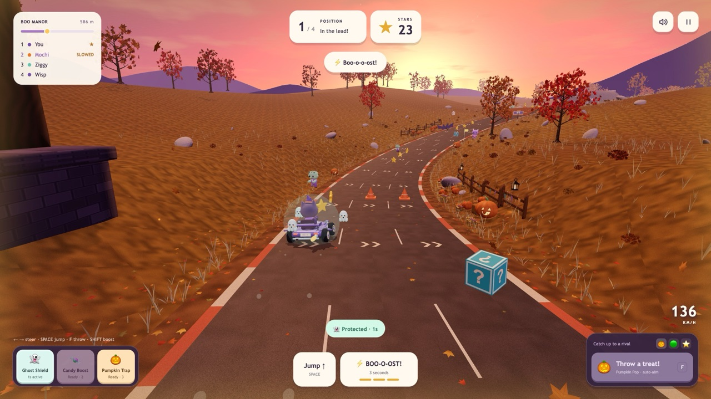
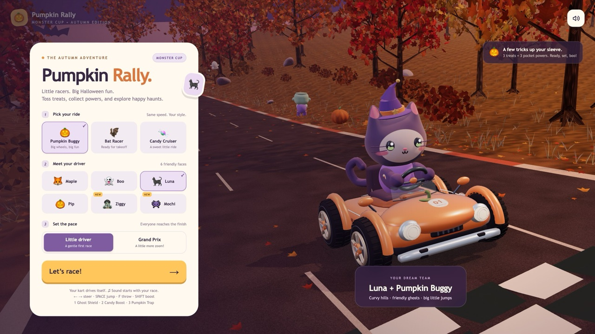

# 🎃 Pumpkin Rally — Monster Cup

A cute Halloween kart race that runs in your browser. Pick a ride and a driver, then race through an autumn forest at sunset: collect stars, toss treats at rivals and use spooky powers.

**▶ Play now: https://madebysourasith-sudo.github.io/pumpkin-rally/**

## Features

- 3 karts (Pumpkin Buggy, Bat Racer, Candy Cruiser) and 6 drivers (Maple, Boo, Luna, Pip, Ziggy, Mochi)
- Two difficulty levels: *Little driver* and *Grand Prix*
- Powers: Ghost Shield, Candy Boost, Pumpkin Trap
- Haunted manor, sunset hills, a tunnel, ramps and a moonlit sky
- Synthesized music and sound effects (no audio files)
- Works on desktop and mobile (touch controls)
- One self-contained HTML file. No build step, no dependencies to install

## Controls

| Action | Keyboard | Touch |
| --- | --- | --- |
| Steer | ← → or A / D | Tap left / right |
| Jump | Space | Jump button |
| Throw a treat | F | Throw button |
| Boost | Shift | Boost button |
| Powers | 1 · 2 · 3 | Power buttons |
| Pause | P or Esc | Pause button |

The kart accelerates by itself, so you only need to steer.

## Run it locally

Download `index.html` and open it in a browser. That's all.

## Built with

- [three.js](https://threejs.org) r160 (MIT), included inline in `index.html`
- Web Audio API for the music and sounds

## License

[MIT](LICENSE). Feel free to play, fork, remix and learn from it.
